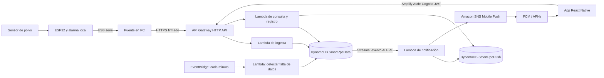

# Smart-PPE: arquitectura del prototipo IoT

Fecha de diseño: 2026-11-05. Alcance: un ESP32, una computadora puente y una aplicación móvil de monitoreo y alertas. Toda la infraestructura de AWS es serverless.

## 1. Decisiones

- **Origen de datos:** el ESP32 conectado por USB a la computadora. Windows lo reconoce como `COM3` mediante un CP2102. Se prepararon dos programas nuevos en `firmware/`: simulación y lectura analógica real, ambos a 115200 baudios. Aún hay que verificar el modelo/cableado y cargar el programa deseado; `ESP32_PMS5003_demo.ino` adjunto no es ninguno de ellos.
- **Puente local:** un proceso en la computadora lee continuamente el puerto serie, agrupa muestras durante 2 segundos y envía una petición HTTPS. Ante un fallo de red descarta ese lote; no convierte lecturas antiguas en alertas nuevas.
- **Backend:** Amazon API Gateway HTTP API, AWS Lambda y Amazon DynamoDB. AWS Amplify se usa en la aplicación React Native para autenticación y acceso a la API existente. No se necesita EC2, RDS ni un servidor permanente.
- **Notificaciones:** DynamoDB Streams activa una Lambda de notificaciones al crear un evento de alerta; Amazon SNS Mobile Push entrega el aviso a FCM (Android) o APNs (iOS). La app debe ser una compilación nativa instalable; una vista web o Expo Go no satisface la alerta con la app cerrada.
- **Historial:** lecturas periódicas y picos/alertas en DynamoDB. S3 no participa en el flujo crítico. Se añadiría solo para exportaciones CSV o archivos de evidencia cuando exista esa necesidad.
- **Alcance de medición:** por ahora, una sola concentración estimada de polvo sin identificación validada de PM2.5, PM10, COV, sílice o toxicidad. Los niveles de la demo no son límites ocupacionales. Hasta conocer el firmware y sensor exactos, el sistema no declara que el aire sea seguro.

## 2. Flujo completo



La alarma física no depende de Internet. La notificación móvil sí depende de la PC puente, la red, AWS y el servicio de push del sistema operativo. No se promete entrega instantánea o garantizada.

### Secuencia de alertas

1. El puente parsea la línea serie y acumula `instantáneo`, `promedio de 2 s`, máximo del lote y número de muestras. Envía un lote cada 2 segundos con `deviceId`, `sequence`, `observedAt` UTC y `mode` (`real`, `simulated` o `unknown`). Los programas nuevos imprimen también `Modo` y `Estado`, que el puente transmite; con el programa anterior sigue siendo `unknown` salvo que se indique manualmente.
2. La Lambda de ingesta valida firma, formato, rango, antigüedad y secuencia. Ignora duplicados y lecturas fuera de orden.
3. La Lambda actualiza el estado actual. Si llega `alarmLevel`, usa ese estado calculado por el ESP32. De lo contrario aplica sus umbrales de **demostración** guardados por dispositivo (75/150 µg/m³ en el despliegue actual), con histéresis y confirmación. Los programas nuevos usan 50/150 µg/m³ y también son solo una demostración. Una transición genera un evento; un estado sostenido no crea una notificación por cada lote.
4. Una transición crea un elemento `ALERT` en DynamoDB. El Stream invoca la Lambda de notificaciones, que consulta los teléfonos registrados y publica por SNS. El `alertId` viaja en el push para abrir el evento en la misma pantalla.
5. Si no llegan datos durante 30 segundos, las consultas muestran `OFFLINE`. EventBridge comprueba cada minuto y crea **una** alerta de desconexión por transición, si corresponde.

**Sincronización con la alarma física:** los nuevos programas imprimen `Estado: NORMAL/WARNING/CRITICAL`, que el puente envía como `alarmLevel`. Así la transición móvil usa el mismo estado que los LEDs después de cargar uno de ellos. La entrega push sigue sujeta a conexión y al sistema operativo.

## 3. Contrato de telemetría

Ejemplo de lote enviado por el puente; los valores son ilustrativos, no una medición:

```json
{
  "schemaVersion": 1,
  "deviceId": "sp32-001",
  "sequence": 1042,
  "observedAt": "2026-11-05T18:30:00Z",
  "mode": "unknown",
  "metric": "dust_estimate",
  "unit": "ug/m3",
  "instant": 42.1,
  "average2s": 39.8,
  "peak2s": 51.2,
  "sampleCount": 20,
  "alarmLevel": null
}
```

El contrato admite una futura métrica PM2.5/PM10 **solo si** se confirma un sensor que la mida. `alarmLevel` es la señal prioritaria cuando el firmware nuevo la expone; con el anterior permanece `null`. Las horas se almacenan en UTC y se muestran en la zona horaria del teléfono.

## 4. DynamoDB

Dos tablas, ambas con capacidad bajo demanda. No se requieren índices secundarios ni operaciones `Scan` para las consultas previstas.

### `SmartPpeData`

Claves: `PK` (String), `SK` (String). DynamoDB Streams habilitado con imagen nueva para detectar elementos `ALERT`.

| Tipo | PK | SK | Datos principales | Consulta |
| --- | --- | --- | --- | --- |
| Estado actual | `DEVICE#sp32-001` | `STATE` | valor actual, promedio, pico, nivel, `lastSeenAt`, última secuencia, umbrales demo, modo | `GetItem` al abrir/actualizar app |
| Lectura histórica | `DEVICE#sp32-001` | `READING#<UTC>#<sequence>` | promedio, pico, muestras, modo, `expiresAt` | `Query` por prefijo y tiempo |
| Alerta o pico | `DEVICE#sp32-001` | `ALERT#<UTC>#<alertId>` | nivel anterior/nuevo, valor, pico, motivo, `alertId`, modo, `expiresAt` | últimas alertas, orden descendente |
| Acceso del trabajador | `USER#<cognitoSub>` | `DEVICE#sp32-001` | rol, fecha de asignación | autorizar consultas y registro push |

El estado se actualiza con cada lote válido. Se conserva una lectura histórica cada 30 segundos y siempre se guarda una alerta en las transiciones. `expiresAt` es TTL Unix en segundos: 7 días para lecturas y 90 días para alertas del prototipo; estado y accesos no caducan. TTL elimina de forma asíncrona, así que la app determina `SIN_DATOS` comparando `lastSeenAt` con la hora actual. Las alertas tienen identificadores deterministas y escrituras condicionales para evitar duplicados cuando la PC reintenta.

### `SmartPpePush`

Claves: `PK = DEVICE#<deviceId>`, `SK = USER#<cognitoSub>#INSTALL#<installationId>`.

Campos: `platform` (`android`/`ios`), `endpointArn` de SNS, `tokenUpdatedAt`, `enabled`. Un trabajador puede registrar varios teléfonos; una nueva instalación reemplaza su token. La Lambda de registro comprueba primero el elemento de acceso de `SmartPpeData`. Los tokens y ARN no se devuelven en la API pública de estado.

**Por qué no S3 para los picos:** el elemento `ALERT` ya contiene hora y valor máximo, y una consulta por clave los devuelve inmediatamente. Consultar un bucket para cada pico añadiría pasos y retraso. Una exportación futura puede escribir CSV en S3 mediante Lambda, fuera del camino de alerta.

## 5. API

| Ruta | Autoriza | Función |
| --- | --- | --- |
| `POST /v1/devices/{id}/telemetry` | firma HMAC del puente, validada por Lambda | ingestar lote y actualizar estado |
| `GET /v1/devices/{id}/status` | JWT de Cognito + asignación | devolver estado, antigüedad y modo |
| `GET /v1/devices/{id}/alerts?limit=10` | JWT de Cognito + asignación | últimas alertas y picos |
| `POST /v1/devices/{id}/claim` | JWT de Cognito + código de vinculación | asignar dispositivo al trabajador |
| `POST /v1/devices/{id}/push-registration` | JWT de Cognito + asignación | registrar token FCM/APNs en SNS |

El secreto HMAC del dispositivo se configura en Lambda y en la PC; no se incluye en el repositorio ni en la app. La firma cubre método, ruta, marca de tiempo y cuerpo. Se rechazan solicitudes antiguas y se controla la repetición mediante `sequence`/`alertId`. La app obtiene su sesión con Amplify Auth/Cognito; un autorizador Lambda valida el JWT y cada función verifica la asignación del trabajador al dispositivo.

## 6. Aplicación móvil

Una sola pantalla de monitoreo inspirada en la imagen de referencia:

1. Estado grande: **Sin alerta por el umbral de prueba**, **Precaución**, **Alerta**, o **Sin datos**. Nunca «zona segura» ni «aire apto» con el sensor actual.
2. Una tarjeta de **concentración estimada de polvo (µg/m³)**, hora de última lectura y aviso si la lectura está vencida. Mostrar `MODO DEMO` cuando `mode = simulated`.
3. Instrucción breve asociada al nivel y últimos ocho eventos. Al tocar una alerta push se abre esta misma pantalla; no se necesita una página de reportes.
4. Actualización al abrir la app, al volver al primer plano y cada pocos segundos mientras esté visible. Las alertas con la app en segundo plano o cerrada se envían por SNS/FCM/APNs. El sistema operativo controla el sonido efectivo; no se puede prometer que sonará si el teléfono está silenciado.

Se eliminan del mockup las tarjetas PM2.5, PM10 y COV, el menú, la barra de cuatro secciones y la «vista previa de alerta» fija. La alerta real aparece solo cuando existe un evento.

## 7. Implementación y verificación

1. **Puente local:** leer COM3, parsear las líneas reales, agrupar muestras, detectar desconexión y generar JSON. Probar con la placa conectada sin modificar firmware.
2. **AWS:** comprobar servicios permitidos en AWS Academy; crear tablas, Lambdas, API Gateway, Cognito, Stream y SNS. Probar ingesta y consulta con un evento marcado como sintético.
3. **Push:** configurar FCM o APNs según el teléfono real; instalar una compilación nativa de React Native y registrar su token. Verificar push con la app abierta, en segundo plano y cerrada.
4. **Integración:** provocar solo una condición de prueba segura; comparar momento de lectura, alarma física, evento en DynamoDB y recepción móvil. Desconectar el USB para probar `SIN_DATOS`.
5. **Validación del sensor:** obtener firmware cargado, modelo y hoja técnica; contrastar lecturas con un instrumento de referencia antes de describir límites de exposición o afirmar que el aire es apto.

### Criterios de aceptación de la demo

- El ESP32 entrega datos por USB y el puente registra dispositivo, hora, modo y lecturas sin perder el puerto.
- Una lectura de prueba llega a API Gateway y se ve en `STATE`; una transición produce un solo `ALERT`.
- La app muestra la lectura más reciente y distingue `SIN_DATOS` de ausencia de alerta.
- El teléfono recibe el evento de alerta con la app en segundo plano y lo abre en la pantalla principal.
- Los datos simulados se identifican como tales en la PC, AWS y app.

## 8. Dependencias pendientes

- Código exacto cargado en la placa, modelo exacto del sensor, conexiones y lógica de LED/alarma. Las fotos sugieren un sensor óptico de polvo distinto del PMS5003 del archivo de demostración, pero no permiten identificar el modelo con certeza.
- Acceso a la cuenta AWS Academy y comprobación de permisos para API Gateway, Lambda, DynamoDB, Cognito, SNS y EventBridge. La arquitectura no presupone que todos estén habilitados en Learner Lab.
- Teléfono objetivo (Android o iOS) y credenciales de FCM o APNs para push real. Una instalación nativa requiere su configuración de notificaciones.
- Umbrales y protocolo de acción definidos por quien supervise seguridad y salud ocupacional. Hasta entonces se usan únicamente umbrales didácticos etiquetados.

## Referencias técnicas

- [API Gateway con autorizador JWT](https://docs.aws.amazon.com/apigateway/latest/developerguide/http-api-jwt-authorizer.html)
- [DynamoDB TTL](https://docs.aws.amazon.com/amazondynamodb/latest/developerguide/TTL.html)
- [SNS Mobile Push y endpoints](https://docs.aws.amazon.com/sns/latest/dg/mobile-push-api.html)
- [SNS con FCM HTTP v1](https://docs.aws.amazon.com/sns/latest/dg/sns-fcm-authentication-methods.html)
- [Amplify React Native con API Gateway existente](https://docs.amplify.aws/react-native/build-a-backend/add-aws-services/rest-api/existing-resources/)
- [Amplify Auth con Cognito](https://docs.amplify.aws/react-native/build-a-backend/auth/set-up-auth/)
- [Push remoto requiere una compilación nativa en Expo](https://docs.expo.dev/push-notifications/faq/)
- [Familia de sensores ópticos de polvo Sharp](https://global.sharp/products/device/lineup/selection/opto/dust/index.html)
